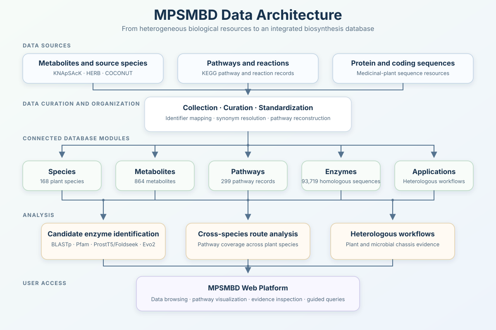
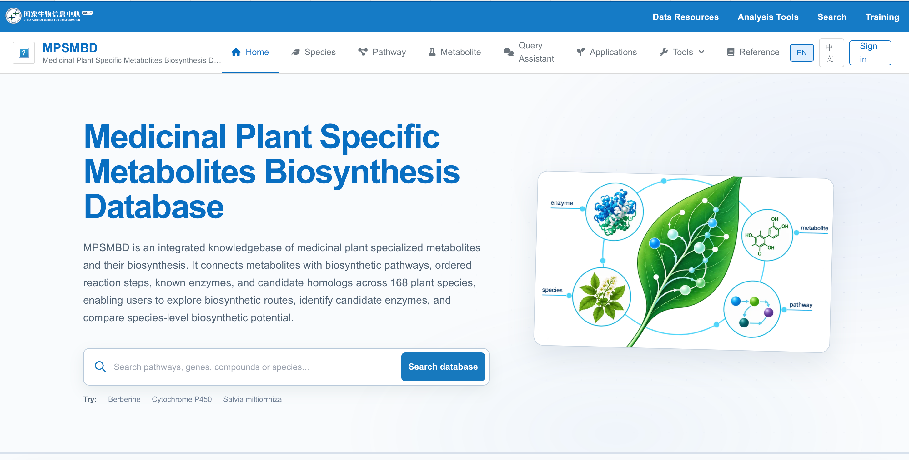
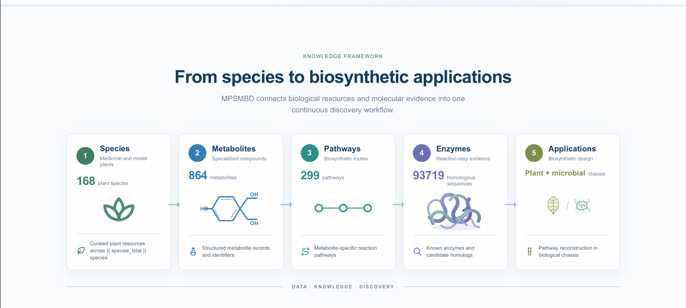
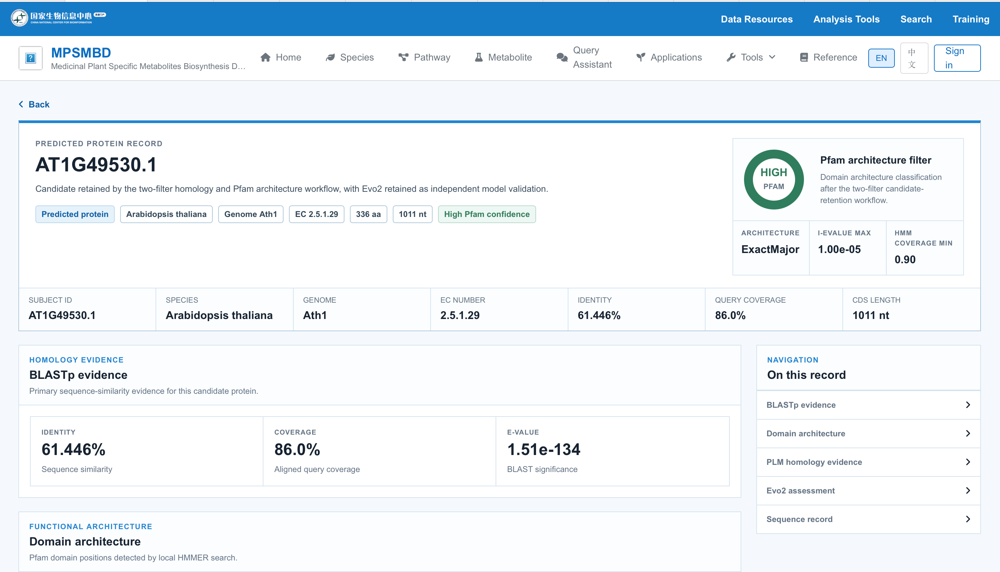

# MPSMBD

**Medicinal Plant-Specific Metabolites Biosynthesis Database**

> A web-based platform for exploring medicinal-plant specialized metabolites, biosynthetic pathways, and enzyme evidence.

## Project overview

MPSMBD is an integrated database for exploring specialized metabolites and their biosynthesis in medicinal plants. It connects species, metabolites, pathways, enzymes, and heterologous biosynthesis workflows through a unified web interface.

The platform combines curated biological data, pathway visualization, candidate enzyme identification, cross-species pathway analysis, and guided database queries.

## Database content and curation

The current database includes:

| Database content | Current scale |
|---|---:|
| Plant species | **168** |
| Specialized metabolites | **864** |
| Biosynthetic pathways | **299** |
| Candidate homologous sequences | **93,719** |

Metabolite records were collected from KNApSAcK, HERB, and COCONUT; pathway and reaction information was derived from KEGG; and plant protein and coding sequences were obtained from medicinal-plant sequence resources. Records were standardized across names, synonyms, chemical identifiers, and external database IDs before integration.

Broad pathway maps were further organized into ordered, metabolite-specific routes that connect compounds, reaction steps, enzymes, and species-level evidence.

## The five connected modules

| Module | Purpose |
|---|---|
| **Species** | Organizes medicinal-plant and model-plant species used for cross-species enzyme analysis. |
| **Metabolites** | Stores metabolite names, synonyms, molecular properties, classifications, external identifiers, and reported source species. |
| **Pathways** | Represents biosynthetic routes, ordered reaction steps, substrates, and products. |
| **Enzymes** | Connects known and candidate enzymes with their reaction steps and supporting evidence. |
| **Applications** | Curates heterologous biosynthesis workflows and supporting literature for plant and microbial chassis. |

Together, these modules allow users to move from a target metabolite to its biosynthetic route, examine the enzymes associated with each reaction step, compare pathway coverage across plant species, and explore relevant heterologous production workflows.

## Candidate enzyme identification

Candidate enzymes are first identified through BLASTp sequence similarity and Pfam domain analysis. MPSMBD then adds protein language model-based structural evidence from ProstT5 and Foldseek, together with DNA language model scores from Evo2.

These model-based results are retained as supporting evidence, allowing users to compare conventional homology results with protein- and DNA-level predictions.

## Core platform capabilities

- Integrated browsing across species, metabolites, pathways, enzymes, and applications
- Ordered representation of metabolite-specific biosynthetic routes and reaction steps
- Candidate enzyme identification combining BLASTp, Pfam, ProstT5, Foldseek, and Evo2
- Integrated sequence, domain, structural, phylogenetic, motif, and language-model evidence
- Cross-species pathway-completeness assessment
- Guided database queries for common research questions

## Product and technical design

| Layer | Role |
|---|---|
| **Web interface** | Supports browsing, filtering, pathway visualization, and evidence inspection. |
| **Django application** | Coordinates views, domain models, and database services. |
| **Relational database** | Stores standardized biological entities and their relationships. |
| **Analysis layer** | Connects candidate enzyme evidence with reaction steps and species-level pathway coverage. |

The system was designed to preserve the relationships among metabolites, pathways, reaction steps, species, enzymes, and their supporting evidence.

## Guided Query Assistant

MPSMBD includes a guided query assistant that connects information already stored across the database. It helps users answer three common questions:

1. Does a metabolite have a known biosynthetic pathway?
2. Which species may contain the required pathway?
3. Which enzymes may catalyze the required reaction steps?

The current version uses structured database queries rather than a large language model. Natural-language interaction and literature retrieval may be added in the future.

## My contributions

- Designed and developed the MPSMBD database and its five interconnected modules
- Collected, curated, standardized, and integrated data from multiple biological resources
- Organized the relationships among metabolites, pathways, reaction steps, species, and enzymes
- Reconstructed ordered, metabolite-specific biosynthetic routes from broader pathway data
- Developed a candidate enzyme workflow combining BLASTp and Pfam with ProstT5, Foldseek, and Evo2 evidence
- Integrated sequence, domain, structural, phylogenetic, motif, and language-model results
- Developed species-level pathway-completeness analysis, including calculations for intermediate metabolites
- Built the web interface and guided query function for exploring the integrated database

## Screenshots and demo

### Platform overview

The homepage summarizes the database scale and provides access to the five connected modules.

### Metabolite details

Chemical properties, classification, source species, and pathway associations.

[**Click to view the full berberine details page (PDF)**](assets/detail_information_pdf/02-metabolite_detail_information.pdf)

### Biosynthetic pathway

Metabolite-specific routes, ordered reaction steps, and producer information.

### Candidate enzyme evidence

Candidate statistics, taxonomic distribution, phylogeny, domains, and motifs.

[**Click to view the full candidate enzyme details page (PDF)**](assets/detail_information_pdf/04-enzyme-evidence.pdf)

### Guided Query Assistant

A structured query linking Berberine to its curated biosynthetic pathway record.

A short video walkthrough is also planned to demonstrate the complete workflow from a target metabolite to pathways, species-level coverage, and candidate enzyme evidence.

See [`demo/README.md`](demo/README.md) for the media checklist and suggested filenames.

## Future development

- Expand the collection of medicinal plants, metabolites, pathways, enzymes, and heterologous workflows
- Improve data standardization, quality control, and evidence validation
- Further evaluate and optimize the candidate enzyme identification workflow
- Improve pathway visualization and cross-species comparison
- Add natural-language queries and literature retrieval as optional supporting features

## Repository scope

This portfolio contains project documentation and approved visual materials only. Restricted research data, unpublished results, proprietary source code, and production credentials are not included.

## Contact

For project discussions, please contact the repository owner through GitHub.

